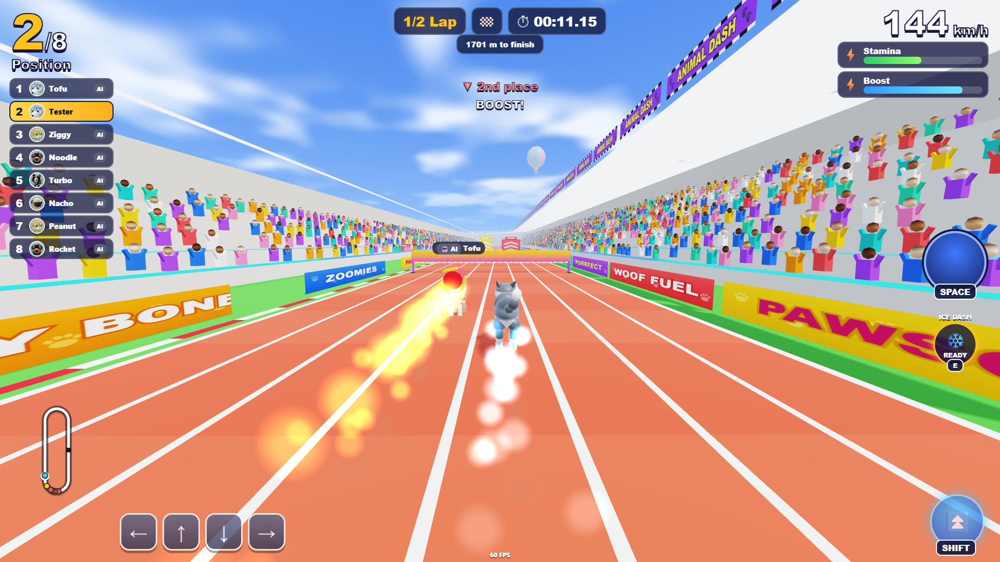

# 🐾 ANIMAL DASH: ULTIMATE RACE

A browser-based 3D animal racing game with real online multiplayer for up to 8 racers.
Arcade racing + obstacle course + party items, rendered with **raw WebGL2** (no Three.js / Babylon.js),
with a **Node.js + TypeScript + Colyseus** server-authoritative multiplayer backend.

* 5 playable animals (Pug, Siberian Husky, Rottweiler, Orange Cat, Black Cat) — procedural rigged 3D models,
  10 animation states each, unique stats and abilities
* 2 maps: **Stadium Sprint** (2-lap athletics oval) and **Crazy Obstacle Arena** (branching routes, pits, rolling balls)
* Stamina + speed boost, 4 boost-gate types, recovery zones, stamina pickups
* 8 power-ups (Chicken Run, Banana Trap, Rocket Boost, Frozen Blast, Shield, Giant Meat, Chaos Bomb, Magnet Paw)
* AI opponents (Easy / Normal / Hard × Aggressive / Defensive / Speed / Balanced personalities)
* Online: Quick Match, Private Rooms with codes (e.g. `DOG888`), AI fill, synchronized countdown, reconnection
* Garage with coins, hats, glasses, outfits, accessories, skins, victory animations and emotes (cosmetic only)
* Procedural audio: synthesized SFX and music, with master / music / SFX volume + mute



---

## 1. Windows installation

Requirements: **Windows 10/11**, **Node.js 18+** (tested with Node 24), **Chrome or Edge** (WebGL2).

```powershell
# from the animal-dash folder
npm --prefix server install
npm --prefix client install
```

## 2. Local development

Open two terminals:

```powershell
npm --prefix server run dev      # Colyseus game server on ws://localhost:2567
```

```powershell
npm --prefix client run dev      # Vite dev server on http://localhost:5173
```

Open <http://localhost:5173>. Single-player works without the server; online modes need it.
To test multiplayer locally, open the game in two browser windows, **CREATE / JOIN ROOM → Create** in one,
and join with the shown code in the other.

### Controls

| Key | Action |
| --- | --- |
| ← / → | Change lane |
| ↑ | Jump (press ↓ in the air to fast-fall) |
| ↓ | Slide / crouch (hold to extend) |
| SHIFT (hold) | Speed boost (uses stamina) |
| SPACE | Use power-up |
| E | Special ability |
| 1-4 | Emotes |
| ESC | Pause |
| Gamepad | D-pad/stick lanes, A jump, B slide, RT/RB boost, X item, Y ability, Start pause |

On-screen ←↑↓→ and boost buttons are also shown during races.

## 3. Production build (single deployment)

```powershell
npm --prefix client run build    # -> client/dist
npm --prefix server run build    # -> server/dist/index.js
$env:NODE_ENV = "production"; $env:PORT = "2567"; node server/dist/index.js
```

The server serves the built client **and** the WebSocket endpoint from the same origin, so players just open
`https://your-domain/` and the client automatically connects to `wss://your-domain`. See
[docs/DEPLOYMENT.md](docs/DEPLOYMENT.md) for public HTTPS/WSS hosting (Docker, Render/Railway/Fly, VPS + Caddy).

## 4. Environment variables

| Variable | Where | Default | Purpose |
| --- | --- | --- | --- |
| `PORT` | server | `2567` | HTTP + WebSocket port |
| `HOST` | server | `0.0.0.0` | Bind address |
| `NODE_ENV` | server | `development` | `production` for deployments |
| `CLIENT_DIST` | server | `../client/dist` | Built client to serve statically (omit to run the API only) |
| `CORS_ORIGINS` | server | `*` | Comma-separated allowed origins when the client is hosted elsewhere |
| `VITE_SERVER_URL` | client build | dev: `ws://localhost:2567`, prod: *(empty)* | Game server URL. Empty in production = same host as the page (`wss://<host>`). Set to `wss://…` when the client is hosted separately (e.g. static CDN). |

Development and production client configs live in `client/.env.development` and `client/.env.production`;
localhost is **never** used for production. Players can also override the server URL in **Settings → Network**.

## 5. Tests

```powershell
npm --prefix server run test:sim   # headless bots race both maps at all difficulties (fairness, items, balance)
npm --prefix server run test:net   # 2 real WebSocket clients: room code, lobby, race, items, reconnect, identical results
# browser end-to-end (needs a running server + built client, uses your installed Chrome):
npm --prefix tools install; $env:GAME_URL="http://localhost:2567"; npm --prefix tools run visual-test
```

Reports: [docs/PERFORMANCE_REPORT.md](docs/PERFORMANCE_REPORT.md), [docs/MULTIPLAYER_TEST_REPORT.md](docs/MULTIPLAYER_TEST_REPORT.md),
screenshots in [docs/screenshots](docs/screenshots).

## 6. Project structure

```
animal-dash/
  shared/src/          deterministic game logic shared by client and server
    sim.ts             race simulation (movement, stamina, items, collisions, finish)
    track.ts tracks.ts track model + the two map layouts
    animals.ts ai.ts   stats/abilities, AI controller
    protocol.ts        network messages, snapshot encoding
    progression.ts     cosmetics catalogue, rewards, profile shape
  client/src/
    engine/            raw WebGL2 renderer, shaders, meshes, particles, textures, math
    characters/        procedural rigged animal models, cosmetics, actor
    animations/        procedural animation state machine (gait driven by distance → no foot sliding)
    tracks/            track path (track space → world) and environment builders
    obstacles/ items/  obstacle, gate, ramp, item-box, entity and effect visuals
    physics/           single-player fixed-timestep driver (local authoritative sim)
    ai/                re-exports the shared AI
    network/           Colyseus client, prediction/reconciliation/interpolation (netRace.ts), config
    game/              app flow, race scene, menu scene, input, profile
    ui/                HUD, DOM helpers, styles
    audio/             procedural SFX + music
  server/src/
    index.ts           Express + Colyseus entry (health, room lookup, static client)
    rooms/RaceRoom.ts  lobby → loading → racing → results room
    state/             Colyseus schema (lobby state)
    systems/           RaceSession (authoritative sim + AI), rate limiter
    network/           room codes, name sanitising
    tests/             sim + network tests
  tools/visualTest.mjs automated browser verification
  docs/                deployment guide, reports, screenshots
```

## 7. Architecture notes

* **One simulation, three uses.** `shared/src/sim.ts` is deterministic (fixed 60 Hz, seeded RNG). The server runs it
  authoritatively; single-player runs it locally; online clients run it in *prediction mode* for their own racer only.
* **Track space.** Physics happens in `(s, x, y)` — distance along the course, lateral offset, height — which makes
  collisions cheap and exact. The renderer maps it onto curved, elevated 3D paths.
* **Netcode.** Clients send only input (held buttons + monotonic action counters) at 30 Hz (+ immediately on button
  edges). The server simulates, then sends 20 Hz snapshots (compact quantized arrays; full state only for the
  receiving player). Clients predict their racer, reconcile with replay of unacknowledged inputs (the server reports
  how many ticks consumed the last acked input so replay is exact) and smooth corrections; other racers are
  interpolated 100 ms in the past. Items, pickups, attacks, racer bumps and results are server-only.
* **Security.** Server-side input validation, room capacity 8, per-client token-bucket rate limiting, unique session
  ids, host-only settings/start, sanitized names/cosmetics, server-controlled item spawning and results. Clients cannot
  submit positions, speeds or results, so speed hacks and teleports have nothing to act on.
* **Future-ready.** `ProfileStore` (client/src/game/profile.ts) is an interface with a local implementation; a
  database-backed store can be added for accounts, leaderboards, friends, ranked matchmaking and seasons.

## 8. Known limitations

See the "Status" sections of the two reports. In short: public multi-network testing must be done by you after
deploying (instructions in DEPLOYMENT.md); characters are procedural low-poly models rather than sculpted assets;
there is no account/database backend yet (progression is stored per browser).
